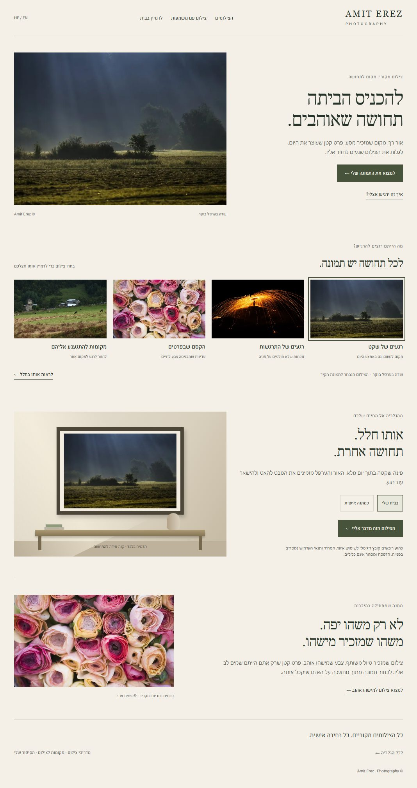
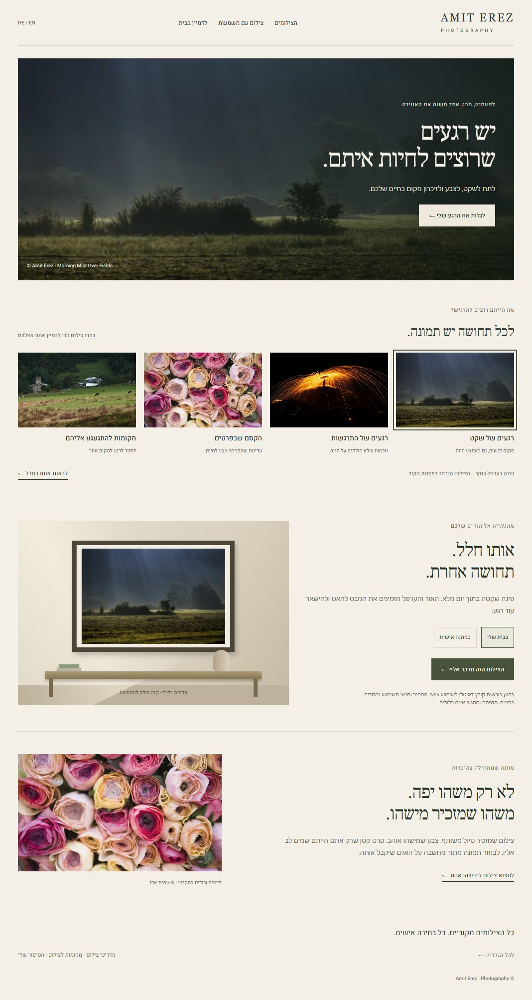
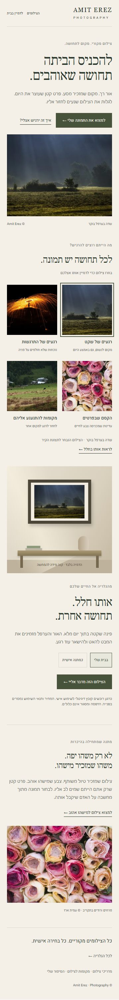

# Amit Photos — סקיצת חוויה ומפת שימור הפיתוחים

26.10.2026 · הצעת עיצוב בלבד · בסיס: `368d02817874e3fb0beea4cc47c5ee3bb265743c` אחרי מיזוג #185.

## מטרת ההצעה

להמחיש מה צילום יכול להוסיף לחיי הקונה: שקט בפינה בבית, צבע, תחושת מקום או בחירה אישית כמתנה. הקובץ הדיגיטלי הוא אמצעי למסירת הצילום; העיצוב מוביל עם הרגש ועם האפשרות לדמיין אותו בחיים.

אין בקשה להחליף או לבנות מחדש את האתר. הכיוון המועדף למימוש הוא שינוי הדרגתי של שכבת התצוגה, עם אותם נתונים, מזהים, התנהגויות וגבולות רכישה.

## שני כיוונים חזותיים

### גלריה חמה — הכיוון המומלץ להתחלה

טיפוגרפיה עברית רגועה, משטח חם ומרווחים נדיבים. הפתיחה משלבת צילום מקורי וטקסט קצר לצד הצילום, בלי להניח טקסט על האזור החשוב בפריים. אחריה אותם ארבעת מסלולי ההשראה, המחשה של הצילום בחלל ומקטע על מתנה בעלת משמעות אישית.

### התמונה במרכז

צילום פנורמי תופס את הפתיחה, וההזמנה להתבוננות מונחת על שכבת הצללה קריאה. זהו כיוון עם יותר נוכחות ואווירה בפתיחה. יתר העמוד נשאר מרווח וכולל את אותם מסלולים וכלים.

### תצוגת טלפון

הצילומים בסקיצה הם תמונות מקוריות שכבר נמצאו במענה הציבורי של `/api/photos`. אין תמונות מלאכותיות או תמונות חדשות שהוכנסו לקטלוג. החלל שמסביב לתצלום הוא הדמיה סכמטית, המסומנת כהמחשה. המסגרת וההדפסה אינן מוצר מוצע.

## מה אפשר לבחון בסקיצה האינטראקטיבית

- בחירה בכל אחד מארבעת המסלולים מחליפה את הצילום בהמחשת הקיר.
- בחירה ב״בבית שלי״ או ב״כמתנה אישית״ משנה את ההקשר הרגשי.
- HE/EN מציגים את שתי שפות העיצוב המוצע.
- כפתור הבירור מציג הודעת סקיצה בלבד; הוא אינו פותח WhatsApp או שולח הודעה.
- מקור הסקיצה נשמר לצד המסמך ב־`experience-concept.html`. זהו מקור להמחשה בשיחה, לא עמוד לשילוב ישיר באתר.

## מפת שימור — מה לא מחליפים

| פיתוח קיים | איך נשמר במימוש עתידי | תנאי קבלה |
|---|---|---|
| ארבעת מסלולי ההשראה | אותם מזהי quiet / wonder / details / places ואותם IDs של הצילומים | אין קטגוריות חדשות; אין שינוי באוצרות או בסדר הצילומים בלי החלטה נפרדת |
| מקור התמונות והחלטות קיורציה | `/api/photos` הציבורי נשאר המקור המאומת; אין הרחבת fallback | מסלול מוסתר אם אין די צילומים ציבוריים; צילום מוסתר אינו מופיע |
| הגלריה והסינון | שומרים `#gallery`, את הפילטרים, החיפוש והבחירה הקיימים | קישור מהמסלול מפעיל את הגלריה הקיימת, לא גלריה חדשה בסקיצה |
| חלון הצילום והסיפורים | משפרים היררכיה חזותית סביב חלון הצילום הקיים | שמונת התיאורים, מעבר שפה, מקלדת, תמונה הבאה/קודמת וסגירה עובדים |
| תצוגת הקיר | משתמשים בכלי הקיים ולא מחליפים אותו בחדר הקשיח שבסקיצה | התמונה, הגודל וההגדרות הקיימות ממשיכים לפעול; ההמחשה מסומנת |
| מועדפים וקישורי שיתוף | אפשר לתת להם משקל חזותי משני, אך לא להסירם | שמירת מועדף, פתיחה חוזרת, קישור ישיר לצילום ושיתוף נשמרים |
| WhatsApp ומסלול הפנייה | אותו קישור אישי עם שם, מזהה וקישור לצילום | אין הודעה שנשלחת אוטומטית; אין טענה שמדובר במכירה שהושלמה |
| תרגומים ונגישות | טקסט חדש נכנס למילון HE/EN; שומרים RTL/LTR וניהול מיקוד | החלפת שפה בחלון פתוח, alt, ניגודיות, מקלדת ו־reduced motion נבדקים |
| מדידה | שומרים את האירועים הקיימים, ללא שכבת מדידה כפולה | אירוע אחד לכל פעולה; אין פרטים אישיים; אין רישום של פתיחת WhatsApp כמכירה |
| תוכן משלים | מדריכים, מקומות לצילום, אודות, הישגים, צילום השבוע, ניוזלטר וגלריות נשארים נגישים | שינוי המיקום/המשקל בעמוד בלבד; אין מחיקת עמודים או קישורים |
| רישיונות ותשלומים | קובץ לשימוש אישי; המחיר בפנייה; אין הבטחת הדפסה או משלוח | PayPal נשאר כבוי. אין שינוי מחיר, D1, Drive, R2, webhook או סודות |
| SEO וביצועים | שומרים נתיבים, canonical, hreflang ומבנה הכותרות | תמונת Hero מותאמת, ללא preload כבד חדש או שינוי מקור התמונות |

### משרד ומתנות

הנושא ״משרד״ הוא כיוון יצירתי אפשרי, אבל כרגע שימוש עסקי/מסחרי אינו זמין. לכן הסקיצה אינה מציעה רכישה לעסק. לפני הוספת מסלול כזה נדרשת החלטה על הזמינות והרישוי.

מקטע המתנה מדגים התאמה רגשית לאדם אהוב. הוא אינו מבטיח מוצר מודפס, אריזה, משלוח, שירות הקדשה או תנאי העברת רישיון שלא אושרו.

## מה אומת כעת

- 80/80 בדיקות Node ממוקדות עברו על עותק העבודה הקיים: Experience, תרגומים, רכישה כבויה, היררכיית בית, אנליטיקה, עמוד עסקים ורישוי.
- בדיקת דפדפן נפרדת לסקיצה: ארבע תמונות נטענו; החלפת צילום והקשר מתנה עובדת; HE/EN עובדים; כפתור הבירור אינו שולח הודעה; רוחבי 390 ו־320 ללא גלילה אופקית; ללא שגיאות JavaScript.
- קובצי האתר לא נערכו כחלק מעבודת הסקיצה. ב־PR הזה נכללים רק מסמך, מקור ההמחשה וצילומי מסך בתוך `docs/design/`.
- אין מיזוג, פריסה לייצור, שינוי דגלים, נתוני תמונות או תצורת שירותים.

הסקיצה אינה הוכחה שכל מימוש עתידי ישמור על ההתנהגות. מימוש ייעשה ב־PR נפרד, עם השוואת התנהגות מול האתר הנוכחי ובדיקת Preview של ה־HEAD המדויק.

## סדר מימוש מוצע לאחר בחירת כיוון

1. לשנות רק את הפתיחה והמשקל החזותי בעמוד הבית. לשמור את הקישור המותנה למסלולים ואת ה־fallback לגלריה.
2. להתאים את פריסת ארבעת המסלולים בלי שינוי מקורות הנתונים או IDs.
3. להוסיף המחשה של צילום בחלל דרך תצוגת הקיר הקיימת ומקטע משמעות אישית/מתנה.
4. לשפר את היררכיית חלון הצילום בלי לשכתב את פעולותיו.
5. להריץ בדיקות קיימות + Chromium/WebKit, 390/768/1280, HE/EN, מקלדת, תשלומים כבויים ומדידה ללא כפילויות.
6. להציג Preview ולבחון אותו לפני בקשת מיזוג. אין מיזוג או פריסה במסגרת סקיצה זו.

## מקורות הצילומים

- [שדה בערפל בוקר](https://amitphotos.com/?photo=1DKV8fePHvPbFLArxDDCRuGsX9eT48ZKd) — רגעים של שקט.
- [מטריית אש](https://amitphotos.com/?photo=1toLLUZrvlD_zP5qosJLEabgyh1WOEWZc) — רגעים של התרגשות.
- [פרחים ורודים בתקריב](https://amitphotos.com/?photo=1T_sZuDJIECAtqscPBtZ1qoi7KECxxmLu) — הקסם שבפרטים.
- [כפר בעמק הירוק](https://amitphotos.com/?photo=1rVBJnzQ8onOOR-qQHUzuK6zr_dMd_vHN) — מקומות להתגעגע אליהם.

הפיתוחים שפורסמו נשארים ב־#181, #184 ו־#185. מפת הדרך הרחבה: [Issue #177](https://github.com/erezfamily-cmyk/amit-photos/issues/177).
